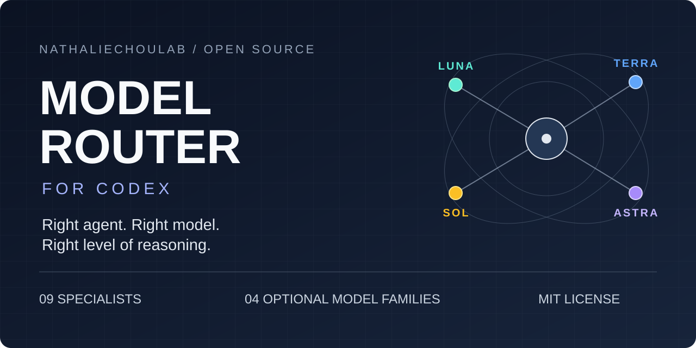
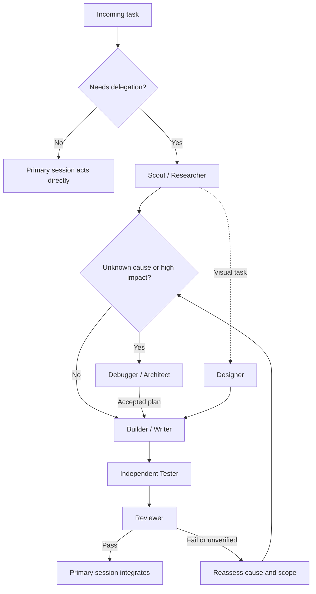

# Model Router for Codex



**Right agent. Right model. Right level of reasoning.**

A lightweight, open-source toolkit for turning OpenAI Codex into a coordinated team of specialized coding agents. Instead of assigning every phase of a task to the same model, Model Router helps Codex select the right specialist, reassess when new evidence appears, and independently verify important changes.

[](LICENSE)
[](#quick-start)
[](#meet-the-agents)
[](https://github.com/NathalieChouLab/model-router-codex-public/actions/workflows/ci.yml)

## Why Model Router?

A one-line fix does not need the same workflow as a difficult architecture decision. A developer who implements a change should not be the only one validating it.

Model Router is designed around three principles:

- **Quality first.** Escalate uncertain or high-impact decisions rather than guessing.
- **Efficiency by design.** Use specialists only when they add value; handle trivial tasks directly.
- **Independent verification.** Separate implementation, tests and review.

No extra orchestration server, proxy, Python packages or API keys are required by the installer. It installs native Codex agent definitions and routing guidance; Codex itself still requires its normal setup and access.

## How it works



Example flow for complex work. Not every task needs every phase. Routing is instruction-based and depends on Codex following the installed guidance; it is not a deterministic dispatch engine.

## Quick start

Requirements: Python 3.11+ and a Codex version supporting custom subagents. Run in a terminal (Windows users can substitute `python` or `py -3.11` for `python3`).

```sh
git clone https://github.com/NathalieChouLab/model-router-codex-public.git
cd model-router-codex-public
python3 install.py --global --dry-run
python3 install.py --global
```

The commands above target the default branch, `main`. For reproducibility, use a known release tag or commit. For a single repository, replace `--global` with `--project /path/to/project`. Restart Codex after installation.

Try a small, read-only task first:

> Use mr_scout to identify the entry point and existing tests in this repository. Return paths and evidence only. Do not edit anything.

For a nontrivial change, explicitly ask Codex to apply Model Router and delegate independent verification.

## Meet the agents

| Agent | Specialization | Example |
|---|---|---|
| `mr_scout` | Local exploration | Find a function, entry point or test |
| `mr_researcher` | External evidence | Check current API documentation |
| `mr_writer` | Documentation | Draft a README or migration guide |
| `mr_builder` | Implementation | Apply an approved code change |
| `mr_tester` | Independent testing | Add regression and edge-case tests |
| `mr_debugger` | Root-cause analysis | Reproduce and isolate a failure |
| `mr_designer` | Visual and interaction review | Assess accessibility and responsive layout |
| `mr_architect` | Architecture and difficult decisions | Evaluate alternatives and plan migrations |
| `mr_reviewer` | Independent verification | Review a diff and test evidence |

Scout, researcher, debugger, designer, architect and reviewer are configured as read-only. Other agents inherit applicable parent permissions; their instructions limit their assigned scope.

## Model profiles: choose portability or specialization

**Inherit (default):** agents use inherited model and reasoning settings. This is the recommended starting point, especially if you are unsure which models your Codex account supports.

**Latest (opt-in):** uses the following proposed role assignments from the bundled profile. Confirm exact model IDs and reasoning-effort support against your Codex account before enabling it. The label latest is a named profile, not a live model-catalog updater.

| Agent | Model ID | Reasoning effort |
|---|---|---|
| Scout | `gpt-6-luna` | low |
| Researcher | `gpt-6.1-terra` | medium |
| Designer | `gpt-6.1-terra` | high |
| Writer | `gpt-6.2-sol` | medium |
| Builder | `gpt-6.2-sol` | high |
| Tester | `gpt-6.2-sol` | high |
| Debugger | `gpt-6.2-sol` | xhigh |
| Architect | `gpt-6.2-astra` | xhigh |
| Reviewer | `gpt-6.2-astra` | high |

```sh
python3 install.py --global --profile latest --dry-run
python3 install.py --global --profile latest
```

Customize groups with `--fast-model`, `--research-model`, `--build-model` and `--astra-model` using exact supported IDs. For custom models, start with the inherit profile and enable `--recommended-efforts` only after checking compatibility. The latest profile always includes the listed efforts. Reinstall with the same options to preserve overrides.

There is no automatic paid-model probe, silent fallback, or guaranteed cost saving. These assignments are design choices, not benchmark rankings.

See the [Codex subagent documentation](https://developers.openai.com/codex/subagents) and [OpenAI model catalog](https://developers.openai.com/api/docs/models).

## Example use cases

| Task | Possible route |
|---|---|
| Fix an obvious typo | Primary session, directly |
| Debug an intermittent failure | Debugger → Builder → Tester → Reviewer |
| Integrate an unfamiliar API | Researcher → Builder → Tester → Reviewer |
| Review a responsive dashboard | Designer → Builder → Reviewer |
| Plan a risky architecture change | Architect → human approval → Builder → Tester → Reviewer |

See [worked task prompts](references/quickstart-prompts.md) for examples you can adapt.

## Installation safety and maintenance

The installer previews changes with `--dry-run`, backs up affected files, refuses unmanaged name collisions, and updates only its marked section in AGENTS.md. It does not edit authentication or config.toml. Upgrading from the five-agent public version retires the managed mr_planner definition and installs mr_architect.

Re-run to update; modified managed agent files are replaced after backup. Unmanaged and unrelated files remain untouched. Use your original scope when uninstalling:

```sh
python3 install.py --global --uninstall --dry-run
python3 install.py --global --uninstall
```

For cloud environments, clone a trusted revision and run the same installer in the target environment.

## Validation and limitations

The installer suite covers configuration parsing, optional model settings, install/update/uninstall, ownership collisions, migration and Windows CRLF handling.

```sh
python3 -m unittest discover -s tests -v
```

[Cross-platform CI](https://github.com/NathalieChouLab/model-router-codex-public/actions/runs/44541675688) recorded 10/10 passing tests on each of macOS, Windows and Ubuntu for the V2 installer fix. This verifies installer behavior, not live model entitlements, delegation quality, security guarantees or performance improvements.

## Project status and roadmap

- [Published releases](https://github.com/NathalieChouLab/model-router-codex-public/releases) · [Changelog](CHANGELOG.md)
- [Model compatibility](docs/compatibility.md) · [Benchmark protocol](docs/benchmarks.md)
- [Development roadmap](ROADMAP.md) · [Security policy](SECURITY.md)

The public edition is an early release: installer CI passes on three operating systems; live model entitlement and routing effectiveness are not yet validated. Contributions of reproducible results are welcome.

## Contributing

Bug reports, documentation improvements and reproducible model-compatibility reports are welcome. See [CONTRIBUTING.md](CONTRIBUTING.md).

If Model Router is useful, star the repository or share a reproducible workflow. Feedback from real projects is especially valuable.

## License

[MIT](LICENSE) · Maintained by [NathalieChouLab](https://github.com/NathalieChouLab).

Independent open-source project, not an official OpenAI product.
